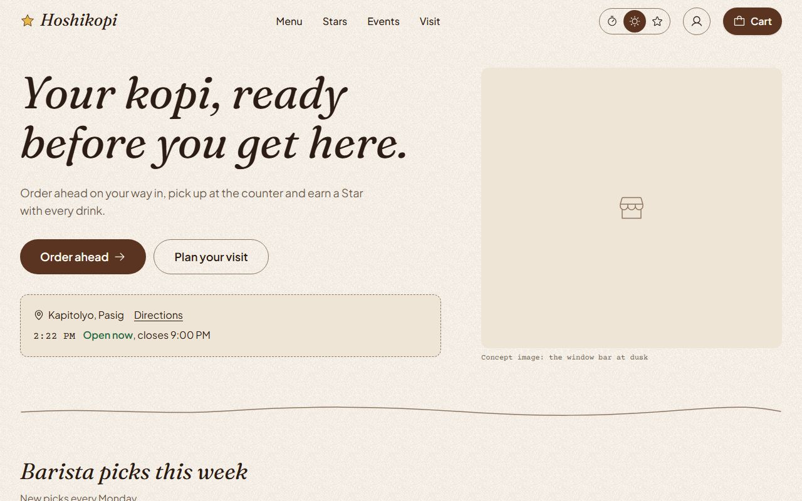
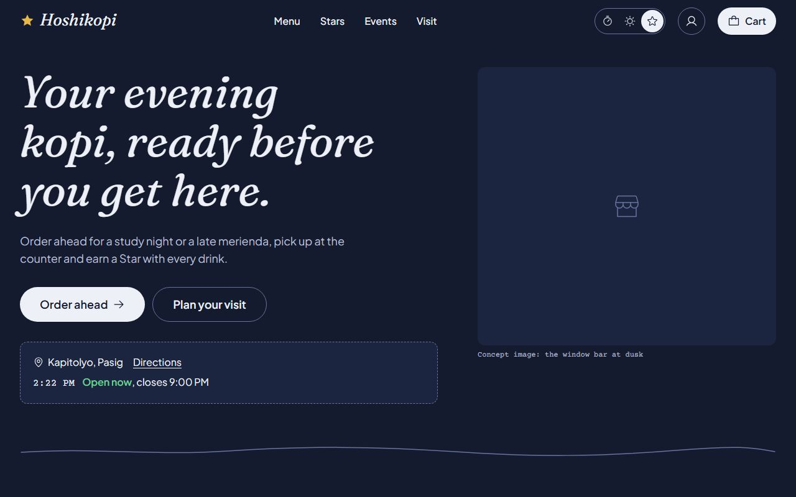
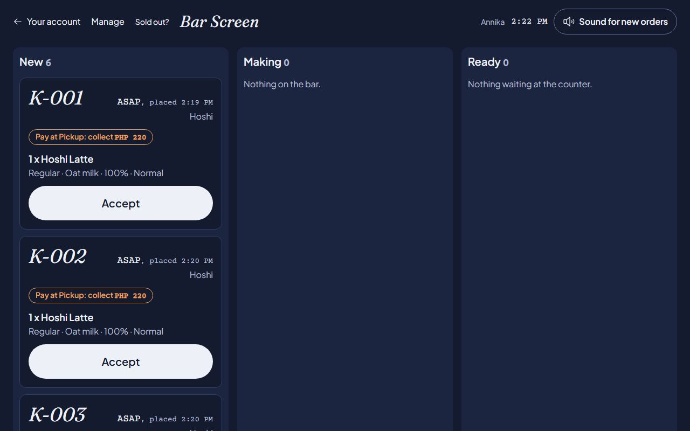
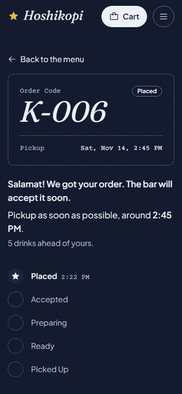

# Hoshikopi

> **In plain words:** Hoshikopi is a website for an invented cafe in Metro Manila. Customers order coffee ahead and pick it up; baristas see the Orders on a tablet behind the counter; the Manager runs the menu and the cafe from the same site. It is a finished portfolio project: it works end to end, but no real money ever moves.
>
> **Who should read it:** everyone, first. The "Start here" table sends each reader to the right document.
> **Last checked:** 2026-11-17.

A concept cafe in Metro Manila, and the website that runs it. The site sells the place and runs the counter. Customers see the space and plan a visit, browse the menu, choose their Options, order ahead and pick up at the counter, pay with GCash, Maya, card or at pickup, and collect Stars toward a free drink. Baristas run live Orders on a Bar Screen; the Manager edits the menu, hours, the cafe's details, Events and Posts. The look follows the cafe's clock: cream paper by day, night sky from 6 PM Manila time.

*Hoshi* is Japanese for star; *kopi* is coffee in Malay and Indonesian, close to the Filipino *kape*.

> **Concept project.** Hoshikopi is a portfolio piece, not a real business. The cafe's address, people, prices and photos are invented, and payments run in Test Mode only: no real money is ever taken.

| | |
| --- | --- |
|  |  |
|  |  |

## Start here

| You are | Read first | Then |
| --- | --- | --- |
| Taking over the project (owner, project manager) | [docs/HANDOFF.md](docs/HANDOFF.md) | [docs/07-ROADMAP.md](docs/07-ROADMAP.md) section 0 |
| Working at the cafe (Barista, Manager) | [docs/STAFF-GUIDE.md](docs/STAFF-GUIDE.md) | [GLOSSARY.md](GLOSSARY.md) for any word that is unclear |
| A developer | [docs/06-SETUP.md](docs/06-SETUP.md) | [CLAUDE.md](CLAUDE.md), then [docs/03-ARCHITECTURE.md](docs/03-ARCHITECTURE.md) |
| A reviewer or recruiter | [docs/CASE-STUDY.md](docs/CASE-STUDY.md) | [docs/DEMO-SCRIPT.md](docs/DEMO-SCRIPT.md), then try it on the live site |

## Status

Built and live at https://hoshikopi.vercel.app, hosted on Vercel with a Neon database. Payments run in Test Mode on the built-in `fake` provider, and the live site sends no email until the project has a domain (visitors sign in with Google).

- **Done: Phases 0 to 10.** The MVP and V1 features, the November audit and its fixes, the portfolio review (the [case study](docs/CASE-STUDY.md), the [measured success metrics](docs/METRICS.md) and the [two-minute demo script](docs/DEMO-SCRIPT.md)), and the rest of the audit backlog. Only 43 small polish items from that audit stay open.
- **In progress: Phase 11.** These handoff docs, then five small fix batches from the [2026-11-17 deep check](docs/audit/2026-11-17.md), which found no serious problem. New features are on hold.

Where things stand on any day: [docs/07-ROADMAP.md](docs/07-ROADMAP.md) section 0.

## Stack

| Part | What it does for the site |
| --- | --- |
| Next.js 16 (App Router, Cache Components) and React 19 | Build the pages and run the server code; public pages are made ahead of time, so they load fast |
| TypeScript | JavaScript with types, so many mistakes show up before the code runs |
| Tailwind CSS 4 | The styling: colours, spacing and the Day and Night palettes |
| PostgreSQL with Prisma | The database, and the tool that reads it and changes its shape (Docker on a developer's computer, Neon when hosted) |
| Better Auth | Sign-in with an email link or Google (Staff then also enter a Second Factor code, which the site checks itself) |
| A payment interface: `fake` and PayMongo | A Test Mode checkout built into the site, and a PayMongo connector ready for test keys |
| Resend | Sends emails once a key is set; until then they go to the terminal on a developer's computer |
| Vercel and Vercel Blob | Hosting, the daily job, and the store for uploaded photos |
| zod, sharp | Check every input; re-encode uploaded photos without their location data |
| Vitest, Playwright with axe, Lighthouse | Tests of the rules against a real database, tests in a real browser with accessibility checks, and speed scores |
| GitHub Actions and Dependabot | Run the checks on every pull request; propose library updates weekly |

## Documents

| Document | What it holds | Read it when |
| --- | --- | --- |
| [docs/HANDOFF.md](docs/HANDOFF.md) | Taking over: the services the site runs on, secrets and access, routine care, what to do when something breaks, what is left | Taking over the project, or something broke |
| [docs/STAFF-GUIDE.md](docs/STAFF-GUIDE.md) | How Baristas and the Manager use the Bar Screen and `/manage` | Working at the cafe, or training someone |
| [CLAUDE.md](CLAUDE.md) | Rules and pointers for every working session | Starting any task |
| [GLOSSARY.md](GLOSSARY.md) | The words the product, code and database use | A term is unclear, or you name something |
| [docs/01-PRD.md](docs/01-PRD.md) | Goals, assumptions, personas, scope by release, requirements with IDs, risks | Deciding what is in or out |
| [docs/02-RESEARCH-CAFES.md](docs/02-RESEARCH-CAFES.md) | What other cafe sites and ordering apps do, with sources and candidate features | Designing a feature |
| [docs/03-ARCHITECTURE.md](docs/03-ARCHITECTURE.md) | Modules, routes, ordering, Order Status, payments, Pickup Windows, Stars, live updates, security, testing | Writing code |
| [docs/04-DATA-MODEL.md](docs/04-DATA-MODEL.md) | Tables, columns, invariants, seed data, migration policy | Touching the database |
| [docs/05-DESIGN-SYSTEM.md](docs/05-DESIGN-SYSTEM.md) | The "star coffee" look: colours, type, components, motion, Bar Screen, accessibility, budgets | Any UI work |
| [docs/06-SETUP.md](docs/06-SETUP.md) | Prerequisites, accounts, getting the code, env vars, database, commands, GitHub, the live deploy, backups | Setting up, or touching the live services |
| [docs/07-ROADMAP.md](docs/07-ROADMAP.md) | Phases 0 to 11, batches with checkboxes, exit criteria, decisions, definition of done | Picking the next piece of work |
| [docs/08-TOOLING.md](docs/08-TOOLING.md) | Which skill fits which job, agents, ports, libraries, machine facts, prompts | Choosing how to work |
| [docs/ASSETS.md](docs/ASSETS.md) | Every shipped file that is not code, its source and licence; the concept images still to make | Adding a font, image or other asset |
| [docs/CASE-STUDY.md](docs/CASE-STUDY.md) | The problem, what was built, the decisions, the quality work, what comes next | Reviewing the project |
| [docs/METRICS.md](docs/METRICS.md) | The PRD's success metrics, measured: order speed, Lighthouse, axe, rule mutations | Checking the numbers |
| [docs/DEMO-SCRIPT.md](docs/DEMO-SCRIPT.md) | The two-minute demo, step by step, with what to say | Showing it to someone |
| [docs/adr/README.md](docs/adr/README.md) | Every decision in one sentence, linking the ADRs (0001 to 0015) that record each one and why | Before changing a decision |
| [docs/audit/README.md](docs/audit/README.md) | The November 2026 audit and the 2026-11-17 deep check: what each found, what is fixed, what is open | Planning fixes |
| [docs/audit/2026-11-17.md](docs/audit/2026-11-17.md) | The 2026-11-17 deep check in plain words, grouped into the Phase 11 fix batches | Working on Phase 11 |

## Getting started

Follow [docs/06-SETUP.md](docs/06-SETUP.md). Every outside account (Neon, Vercel, PayMongo, Resend, Google) is optional at first; local stand-ins run the whole site.

## Project copy

The project lives on GitHub: https://github.com/xtiannjose/Hoshikopi. It is public and it is the project's only copy, so nothing secret ever goes in it.
