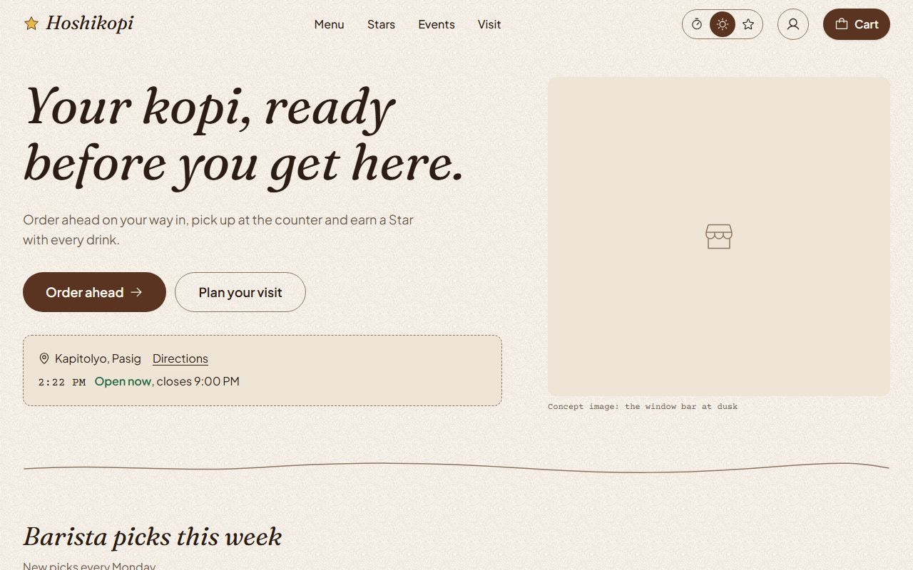
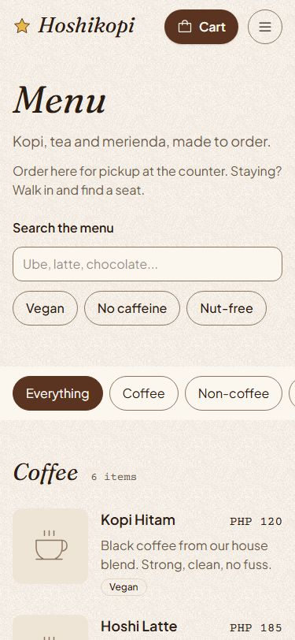
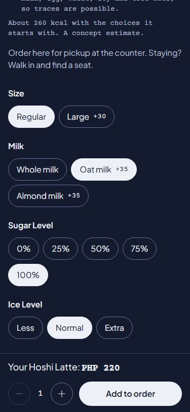
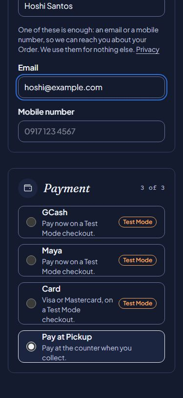
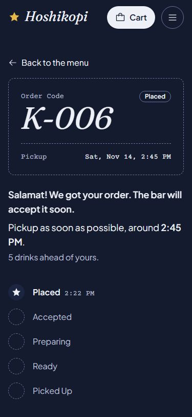
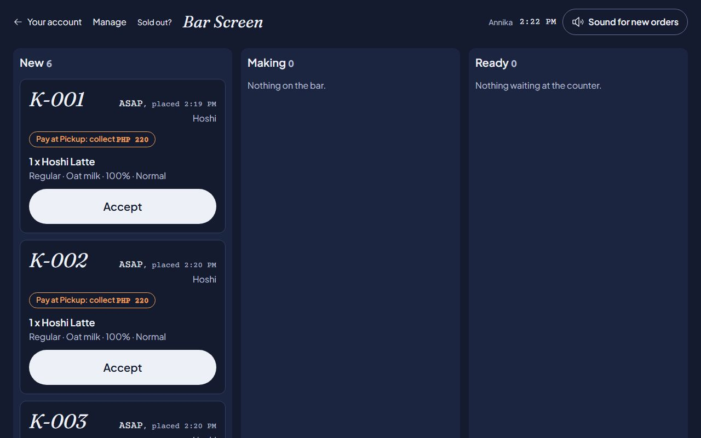

# Hoshikopi: a case study

A concept cafe in Metro Manila and the website that runs it: order ahead for pickup, pay, collect Stars, and a Bar Screen for the baristas. A portfolio project. The cafe, its people and its photos are invented, and no real money moves ([ADR 0006](adr/0006-concept-project-no-real-money.md)).

**Live demo:** https://hoshikopi.vercel.app · **Code:** https://github.com/xtiannjose/Hoshikopi

## The problem

A neighbourhood cafe in Manila loses the morning rush to the queue. People who would buy a kopi on the way to work skip it when the line is out the door, and the bar gets ten orders at once and then nothing. The usual fixes are a delivery app, which takes a large cut and hides the cafe's own brand, or a generic online store, which knows nothing about how a coffee bar works.

I wanted a site that does both jobs a small cafe needs:

- **Sell the place:** the room, the menu, the hours, the events, so people want to visit.
- **Run the counter:** take orders ahead without promising more than the bar can make, take payment the way Filipinos pay (GCash, Maya, card, or cash at pickup), reward regulars, and give the baristas one screen that shows what to make next.

## What it does

| Customers | Staff |
| --- | --- |
| Browse the menu, choose Options (size, milk, sugar, ice) and see the price change as they choose | The **Bar Screen**: new Orders chime in, and one tap moves each one through Accepted, Preparing, Ready and Picked Up |
| Order ahead for As Soon As Possible or a 15-minute Pickup Window, as a Guest or a Member | The Manager edits the menu, prices, Sold Out, hours, Capacity, Prep Time, Events and Posts |
| Pay with GCash, Maya or card in a Test Mode checkout, or at the counter | Pause ordering or turn on Busy Mode when the bar is swamped |
| Watch the Order move live on its own page, with a chime when it is Ready | Refunds, a day's Orders and sales, and Star adjustments |
| Collect a Star per drink; nine make a free drink | A Second Factor for every Manager screen |

The look follows the cafe's own clock: cream paper by day and a night sky from 6 PM Manila time, for every visitor wherever they are ([ADR 0010](adr/0010-theme-follows-manila-time.md)).

| | | | |
| --- | --- | --- | --- |
|  |  |  |  |

## How it is built

**Stack:** Next.js 16 (App Router, Cache Components), React 19, TypeScript, Tailwind CSS 4, PostgreSQL through Prisma (Docker locally, Neon hosted), Better Auth (email link and Google), Vercel with Vercel Blob, and Resend for email once a domain is verified. Tests: Vitest against a real Postgres database, Playwright with axe, Lighthouse.

**One app, nine modules** ([ADR 0001](adr/0001-modular-monolith-nextjs.md)): `cafe`, `cart`, `content`, `identity`, `loyalty`, `menu`, `notify`, `ordering` and `payments`. Each owns its tables and is imported only through its `index.ts`. A lint rule, run as a test, fails the suite if one module reaches into another's internals.

**Public pages are prerendered** and refreshed by cache tag (`menu`, `hours`, `content`), so the menu loads like a static site. When a Manager changes a price, only the pages that show it are rebuilt. Server Components are the default. The few client components are small leaves with state, and there is no component or animation library, only native elements and CSS ([ADR 0011](adr/0011-native-elements-and-css.md)).

## Decisions that shaped it

Fifteen ADRs record the decisions and why. These six did the most:

1. **Money is integer centavos** ([0002](adr/0002-money-as-integer-centavos.md)). `PHP 165.00` is `16500`, and one file formats it. The server prices everything: the browser's total is only displayed, never trusted. A Reward, a Price Delta and VAT are all integer arithmetic, so there are no rounding surprises.
2. **Pickup Windows with Capacity and an honest Prep Time** ([0007](adr/0007-pickup-windows-and-capacity.md)). Orders land in 15-minute windows, each holding a set number of drinks. The check runs under a row lock inside the transaction that places the Order, so two phones can't both take the last slot. Prep Time counts the drinks already on the bar, plus this Order's own, plus Busy Mode. A full window is never offered.
3. **Order Status changes only through `transition()`**, against one table of who may move an Order from where to where. The Bar Screen, the webhook, the Customer's cancel and the expiry sweep all go through it, and every move writes an `order_events` row.
4. **Payment state comes only from verified webhooks** ([0003](adr/0003-payments-paymongo-test-mode.md)). The return URL decides nothing. Events are deduplicated under a unique key, and a payment that arrives after its Order closed is refunded. Payments sit behind an interface with a PayMongo adapter that refuses live keys, and a `fake` provider that refuses production domains.
5. **Stars are a ledger, not a number** ([0008](adr/0008-stars-ledger.md)). Every earn, reserve, release, reverse and adjust is a row, and the balance is their sum. A cancelled Order releases its reserved Stars in the same transaction that cancels it.
6. **Polling before realtime** ([0009](adr/0009-live-updates-by-polling.md)). The Bar Screen asks every 3 seconds with a version string, and the server answers "no change" cheaply. The Order page slows down once the Order is Ready. That is enough for one cafe, and it runs on Vercel's free tier.

Two later decisions came from watching the demo. Being honest about a concept project ([0012](adr/0012-concept-images-with-stand-ins.md)) means every invented detail is labelled and photos have labelled stand-ins until real ones exist. **Demo Mode** ([0015](adr/0015-demo-mode-visitor-plays-the-barista.md)) lets a reviewer who opens the link alone play the barista on their own Order, and the hosted demo takes Orders all day, so it works from any time zone.

## Quality

**The tests are built around the rules that cost money or trust.** Money, Capacity, Prep Time, Stars, Order Status and the webhook handlers were each written test-first against the real test database. In a Phase 9 spot-check, 7 rule mutations (a Price Delta dropped, a Reward ignored, Capacity off by one Order, a skipped Order Status step, a Reward drink earning a Star, Prep Time rounding, centavos dropped) were each caught by the suite. One was caught only after the spot-check found the gap and a test was widened ([METRICS.md](METRICS.md#3-rules-that-fail-their-tests-when-broken)).

**An audit, then the fixes.** Before calling it done, I had the whole site audited across 16 areas: security, payments, ordering, data, performance, accessibility, staff tools, customer journeys, motion, tests, operations and more. That produced 371 findings. Each one was double-checked by a second reviewer before it was ranked, leaving 205 open items: 2 P0, 18 P1, 142 P2 and 43 P3 ([audit/2026-11-13.md](audit/2026-11-13.md)). Both P0s and 17 of the 18 P1s are fixed, one small pull request at a time, each with a test that failed first. The 18th P1 is data on the live site that the Manager refreshes. Ten small P2 fixes followed. A few examples of what the audit caught:

- A Category with no stand-in icon crashed the whole menu.
- The hosted demo was closed for most of a reviewer's day in Europe and the US.
- ASAP always promised 5 minutes, whatever was already on the bar.
- Keyboard focus dropped to the page body after every client navigation, because Next.js 16 keeps the old page in the DOM hidden.
- Under reduced motion, one Day and Night switch started 645 CSS transitions.

**CI** runs lint, Prettier, the type check, Vitest against a Postgres service and `npm audit` on every pull request. Dependabot opens grouped weekly updates.

## The numbers

Measured 2026-11-14 ([METRICS.md](METRICS.md)):

| | |
| --- | --- |
| A Guest orders and pays on a throttled phone (4x CPU, slow 4G) | 8.7 to 9.1 s, target under 60 s |
| Mobile Lighthouse Performance, local build | Home 89, `/menu` 91, a Menu Item 91 |
| Lighthouse Accessibility | 100 on all three |
| axe violations (WCAG 2.2 AA tags), both palettes, 375 and 1280 px | 0 |
| JavaScript on first load | under 170 kB on the 7 main public pages (a test) |
| Tests | Vitest 256, Playwright 233 (191 run per pass, the rest are size-specific) |
| Code | about 23,600 lines of TypeScript in `src`, 7,600 in tests, 210 commits |

## How I worked

The project was planned before any code was written. There is a PRD with requirement IDs, an architecture document, a data model, a design system, a glossary every name in the code follows, and a roadmap of small batches with a definition of done. I built it with Claude Code as the coding agent, working batch by batch from that roadmap. I set the scope, made the decisions the ADRs record, and reviewed and merged each pull request. Each batch is one branch and one pull request with Conventional Commits, merged into `main` with a merge commit.

## What I would do next

- **Real launch requirements:** business registration, BIR-compliant receipts, the Internet Transactions Act, live PayMongo keys, the senior citizen and PWD discount (20% plus VAT exemption), real photos and real staff.
- **A verified email domain**, so the live demo can send links to any address instead of Google sign-in only.
- **Push notifications to a locked phone** through an installable app, instead of a chime on an open page.
- **Server-Sent Events** in place of polling, if the polling cost or delay is ever measured as a problem.
- **The rest of the audit backlog:** about 130 P2 and 43 P3 items. Among them: editing a drink's Options in the Cart, letting the Manager remove an Event Sign-up, a retention job for old rate-limit rows and abandoned Carts, and getting Home back above 90 on Lighthouse.
