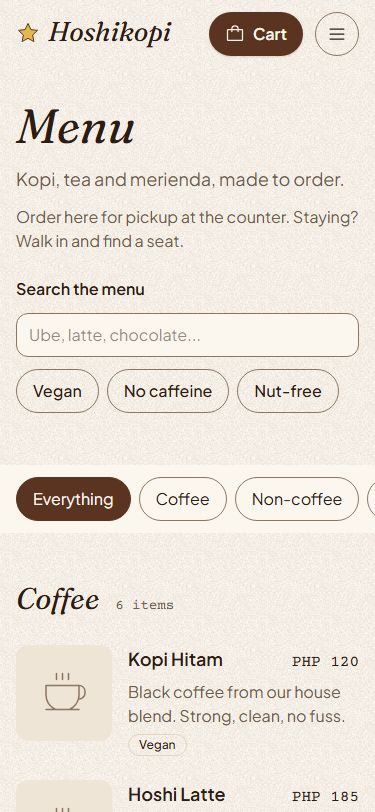
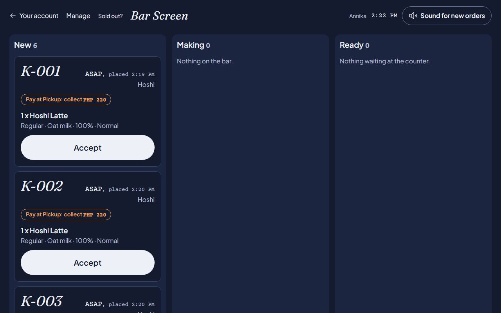

# Hoshikopi: a case study

> **In plain words:** This is the story of building Hoshikopi, told by the person who built it. It covers the problem it solves, what the site does, how it is made, the decisions that mattered and the measured results. Technical words are explained where they first appear, and every number is kept.
>
> **Who should read it:** reviewers, clients, employers, and anyone deciding whether to hire, trust or continue the project. The owner can use it as a one-page summary of the whole build. The first three sections need no technical background.
> **Last checked:** 2026-11-18 (the measured numbers are from 2026-11-14).

## Contents

1. [The problem](#the-problem)
2. [What it does](#what-it-does)
3. [How it is built](#how-it-is-built)
4. [Decisions that shaped it](#decisions-that-shaped-it)
5. [Quality](#quality)
6. [The numbers](#the-numbers)
7. [How I worked](#how-i-worked)
8. [What I would do next](#what-i-would-do-next)

Hoshikopi is a concept cafe and the website that runs it. Customers order ahead for pickup, pay, and collect Stars (the loyalty points: one per drink, nine for a free drink). Baristas use a Bar Screen, a page on a tablet behind the counter.

It is a portfolio project. The cafe, its people and its photos are invented, and no real money moves ([ADR 0006](adr/0006-concept-project-no-real-money.md)). Product words such as Menu Item, Order Code and Pickup Window are defined in the [Glossary](../GLOSSARY.md).

**Live demo:** https://hoshikopi.vercel.app · **Code:** https://github.com/xtiannjose/Hoshikopi

## The problem

A neighbourhood cafe loses the morning rush to the queue. People who would buy a kopi on the way to work skip it when the line is out the door. The bar gets ten orders at once, and then nothing.

The usual fixes fall short:

- **A delivery app** takes a large cut and hides the cafe's own brand.
- **A generic online store** knows nothing about how a coffee bar works.

I wanted a site that does both jobs a small cafe needs:

- **Sell the place:** the room, the menu, the hours and the events, so people want to visit.
- **Run the counter:**
  - take orders ahead without promising more than the bar can make;
  - take payment the way Filipinos pay: GCash, Maya, card, or cash at pickup;
  - reward regulars;
  - give the baristas one screen that shows what to make next.

## What it does

Customers get a menu they can customize and a way to order ahead. Staff get one screen to run the counter, and an admin area to run the cafe.

| Customers | Staff |
| --- | --- |
| Browse the menu, choose Options (size, milk, sugar, ice) and see the price change as they choose | The **Bar Screen**: new Orders chime in, and one tap moves each one through Accepted, Preparing, Ready and Picked Up |
| Order ahead for As Soon As Possible or a 15-minute Pickup Window, as a Guest or a Member | The Manager edits the menu, prices, Sold Out, hours, Capacity, Prep Time, Events and Posts |
| Pay with GCash, Maya or card in a Test Mode checkout (practice payments, no real money), or at the counter | Pause ordering, or turn on Busy Mode (extra minutes added to the wait) when the bar is swamped |
| Watch the Order move live on its own page, with a chime when it is Ready | Refunds, a day's Orders and sales, and Star adjustments |
| Collect a Star per drink; nine make a free drink | A Second Factor (a 6-digit code from an authenticator app) for every Manager screen |

The look follows the cafe's own clock: cream paper by day, and a night sky from 6 PM Manila time. Every visitor sees the cafe's time, wherever they are ([ADR 0010](adr/0010-theme-follows-manila-time.md)).

| | | | |
| --- | --- | --- | --- |
|  |  |  |  |

## How it is built

This section is for readers who want to know what the site is made of. Skip to "Decisions" if you only want the reasoning.

**The tools it is built from:**

| Tool | What it does |
| --- | --- |
| Next.js 16 | The web framework. App Router and Cache Components are its newer ways to organise pages and keep built pages ready. |
| React 19 | Draws the screens |
| TypeScript | JavaScript with type checking, which catches mistakes early |
| Tailwind CSS 4 | Styling |
| PostgreSQL, through Prisma | The database, and the tool that talks to it. Docker runs it on my PC; Neon hosts it online. |
| Better Auth | Sign-in by email link and Google |
| Vercel, with Vercel Blob | The host, and its storage for uploaded photos |
| Resend | An email service, once a domain is verified. It is not set up yet, so the demo sends no email. |
| Vitest | Tests of the rules, against a real Postgres database |
| Playwright, with axe | Tests that drive a real browser; axe finds accessibility mistakes |
| Lighthouse | Google's page-quality score |

**One app, nine modules** ([ADR 0001](adr/0001-modular-monolith-nextjs.md)). The modules are `cafe`, `cart`, `content`, `identity`, `loyalty`, `menu`, `notify`, `ordering` and `payments`. Each owns its own tables, and other code reaches it only through its `index.ts` file. A lint rule, run as a test, fails if one module reaches into another's insides.

**Public pages are prerendered** (built ahead of time), so the menu loads like a static site. Each page is refreshed by a cache tag: `menu`, `hours` or `content`, a label that says which saved pages to rebuild. When a Manager changes a price, only the pages that show it are rebuilt.

**Server first.** Server Components (code that runs on the server, not in the visitor's browser) are the default. The few client components (code that runs in the browser) are small pieces with state. There is no component or animation library, only native elements and CSS ([ADR 0011](adr/0011-native-elements-and-css.md)).

## Decisions that shaped it

An ADR (architecture decision record) is a short note that records one decision and why it was made. Fifteen of them are in [docs/adr/](adr/). These six did the most:

1. **Money is integer centavos** ([0002](adr/0002-money-as-integer-centavos.md)). `PHP 165.00` is stored as `16500`, and one file formats it. The server prices everything: the browser's total is only shown, never trusted. A Reward, a Price Delta and VAT are all whole-number sums, so there are no rounding surprises.
2. **Pickup Windows with Capacity and an honest Prep Time** ([0007](adr/0007-pickup-windows-and-capacity.md)).
   - Orders land in 15-minute windows, each holding a set number of drinks.
   - The check runs inside the transaction that places the Order (a group of database changes that all happen or none do). It holds a row lock, so the database makes a second request wait its turn. Two phones can't both take the last slot.
   - Prep Time counts the drinks already on the bar, plus this Order's own, plus Busy Mode. A full window is never offered.
3. **Order Status changes only through `transition()`**. One table says who may move an Order from where to where. The Bar Screen, the payment webhook, the Customer's cancel and the expiry sweep all go through it, and every move writes an `order_events` row.
4. **Payment state comes only from verified webhooks** ([0003](adr/0003-payments-paymongo-test-mode.md)).
   - A webhook is a message the payment company's server sends ours when a payment changes. The return URL, the page the customer lands on after paying, decides nothing.
   - Each event is recorded once, under a unique key. A payment that arrives after its Order closed is refunded.
   - Payments sit behind one interface with two versions. The PayMongo adapter refuses live keys. The `fake` provider, a stand-in payment page, refuses production domains.
   - The demo runs on `fake`. PayMongo paused new sign-ups in November 2026, so I never set up an account. The PayMongo adapter is built and unit-tested, but has not run against PayMongo's test system.
5. **Stars are a ledger, not a number** ([0008](adr/0008-stars-ledger.md)). Every earn, reserve, release, reverse and adjust is a row, and the balance is their sum. A cancelled Order gives its reserved Stars back in the same transaction that cancels it.
6. **Polling before realtime** ([0009](adr/0009-live-updates-by-polling.md)). Polling means asking again on a timer. The Bar Screen asks every 3 seconds with a version string, and the server answers "no change" cheaply. The Order page slows down once the Order is Ready. That is enough for one cafe, and it runs on Vercel's free plan. The alternative, a connection the server keeps open, is in the last section.

Two later decisions came from watching the demo:

- **Honest about a concept** ([0012](adr/0012-concept-images-with-stand-ins.md)). Every invented detail is labelled, and photos have labelled stand-ins until real ones exist.
- **Demo Mode** ([0015](adr/0015-demo-mode-visitor-plays-the-barista.md)). A reviewer who opens the link alone can play the barista on their own Order. The hosted demo takes Orders all day, so it works from any time zone.

## Quality

This section says how I checked the work: tests for the rules that matter, two full audits, and automatic checks on every change.

**The tests are built around the rules that cost money or trust.** Money, Capacity, Prep Time, Stars, Order Status and the webhook handlers were each written test-first, against the real test database. In a Phase 9 spot-check, I broke 7 rules on purpose, one at a time:

- a Price Delta dropped;
- a Reward ignored;
- Capacity off by one Order;
- a skipped Order Status step;
- a Reward drink earning a Star;
- Prep Time rounding;
- centavos dropped.

The tests caught each one. One was caught only after the spot-check found the gap and a test was widened ([METRICS.md](METRICS.md#3-rules-that-fail-their-tests-when-broken)).

**An audit, then the fixes.** Before calling it done, I had the whole site audited across 16 areas, including security, payments, ordering, data, speed, accessibility, staff tools and tests. That produced 371 findings. A second reviewer double-checked each one before it was ranked, which left 205 open items: 2 P0, 18 P1, 142 P2 and 43 P3 ([audit/2026-11-13.md](audit/2026-11-13.md)). P0 means fix now, P1 serious, P2 should fix, P3 polish.

All of them are now fixed, or decided with a written reason, one small pull request at a time (a pull request is a proposed change that I review before it joins the project). Each fix came with a test that failed first. The only item left is a look at the live site's demo dates, which the owner does. A few examples of what the audit caught:

- A Category with no stand-in icon crashed the whole menu.
- The hosted demo was closed for most of a reviewer's day in Europe and the US.
- ASAP always promised 5 minutes, whatever was already on the bar.
- Keyboard focus dropped to the page body after every move between pages, because Next.js 16 keeps the old page around, hidden.
- Under reduced motion, one Day and Night switch started 645 CSS transitions.

**A second deep check.** On 2026-11-17 I had the whole app checked again, for security, quality and code. It found no P0, 2 P1, 29 P2 and 15 P3, each explained in plain words in [audit/2026-11-17.md](audit/2026-11-17.md). Phase 11 fixed all of them the same day.

**Automatic checks on every change.** CI (continuous integration) runs on every pull request:

- lint, a style and mistake checker;
- Prettier, a code formatter;
- the type check;
- the Vitest tests, against a Postgres database;
- a scan for known security problems in the libraries used.

Dependabot, a GitHub bot, proposes library updates every week.

## The numbers

These are the results of the five targets set at the start:

- **Lighthouse** scores a page out of 100.
- **axe** counts accessibility mistakes, against WCAG 2.2 AA, the international standard.
- **A throttled phone** is a test that slows the computer and network to a mid-range phone's speed.

Measured 2026-11-14 ([METRICS.md](METRICS.md)). Later batches changed the code, so measure again before quoting them as current.

| What | Result |
| --- | --- |
| A Guest orders and pays on a throttled phone (4x CPU, slow 4G) | 8.7 to 9.1 s, target under 60 s |
| Lighthouse on the live site (PageSpeed Insights, mobile and desktop) | 100 for Performance, Accessibility and Best Practices on Home and `/menu` |
| Mobile Lighthouse Performance, local build | Home 89, `/menu` 91, a Menu Item 91 |
| Lighthouse Accessibility | 100 on all three |
| axe violations (WCAG 2.2 AA tags), both palettes, 375 and 1280 px | 0 |
| JavaScript on first load | under 170 kB on the 7 main public pages (a test) |
| Tests | Vitest 256, Playwright 233 (191 run per pass, the rest are size-specific) |
| Code | about 23,600 lines of TypeScript in `src`, 7,600 in tests, 210 commits |

## How I worked

This section says how one person built a project this size.

The project was planned before any code was written:

- a PRD with requirement IDs;
- an architecture document and a data model;
- a design system;
- a glossary that every name in the code follows;
- a roadmap of small batches, with a definition of done.

I built it with Claude Code as the coding agent, working batch by batch from that roadmap. I set the scope, made the decisions the ADRs record, and reviewed and merged each pull request. Each batch is one branch and one pull request. Commit messages follow Conventional Commits, a standard way to word them. Each pull request is merged into `main`, the project's main line, with a merge commit.

## What I would do next

The [roadmap](07-ROADMAP.md) is the source of truth for what is scheduled. These are the things I would do beyond it:

- **Real launch requirements:** business registration, BIR-compliant receipts, the Internet Transactions Act, live PayMongo keys, the senior citizen and PWD discount (20% plus VAT exemption), real photos and real staff.
- **A verified email domain**, so the live demo can send sign-in links to any address, not only Google sign-in.
- **Push notifications to a locked phone**, through an installable app, instead of a chime on an open page.
- **Server-Sent Events** in place of polling, if the polling cost or delay is ever measured as a problem.

## Where to go next

- See it working: [docs/DEMO-SCRIPT.md](DEMO-SCRIPT.md), then the [live site](https://hoshikopi.vercel.app).
- The numbers in detail: [docs/METRICS.md](METRICS.md).
- Every other document: the [docs map](README.md).
